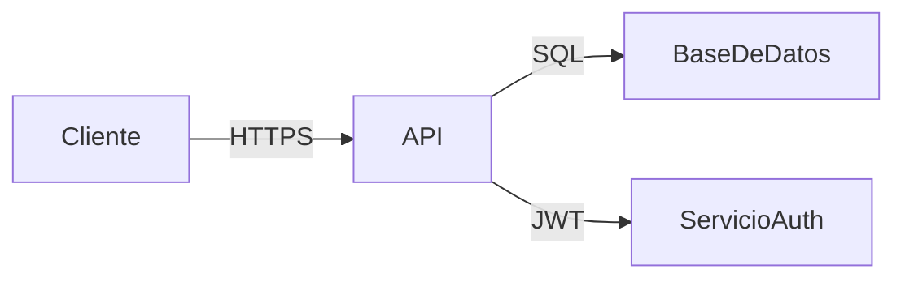

# Mi Proyecto

## Tabla de contenidos
- [Instalación](#instalación)
- [Uso](#uso)
- [Arquitectura](#arquitectura)
- [Contribuidores](#contribuidores)

## Tecnologías
| Tecnología | Versión | Propósito          |
| ---------- | ------- | ------------------ |
| Node.js    | 18.x    | Servidor backend    |
| React      | 18.x    | Interfaz de usuario |
| MongoDB    | 6.x     | Base de datos       |

## Arquitectura

## Capturas
%2012.34.38 a.m..png)

## Contribuidores
- [@tu-usuario](https://github.com/mateoazabache-art) — Desarrollo y documentación
